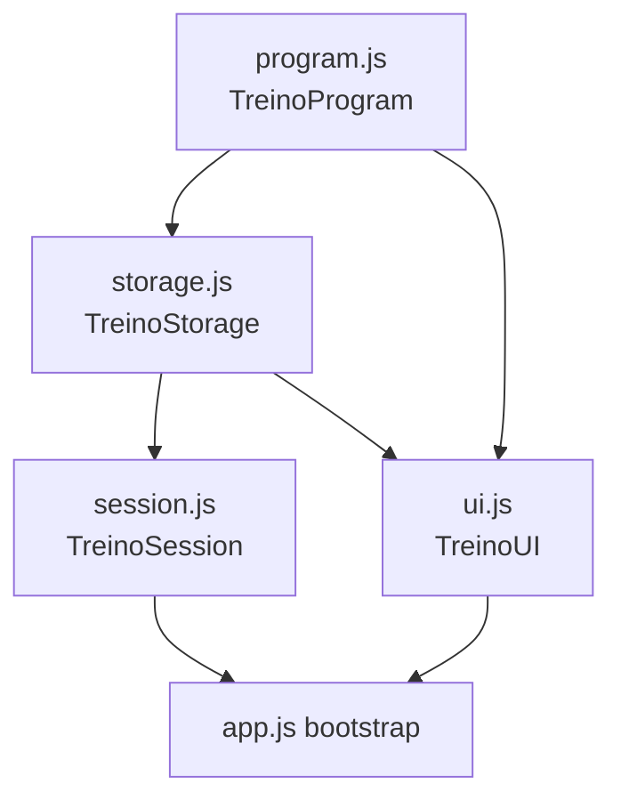

# Architecture

Static app (HTML/CSS/JS) with no build step and no backend. All state lives in the browser `localStorage`.

## Module load order

Scripts are loaded in `index.html` in this order (each is an IIFE exposing a global):

1. `js/program.js` → `window.TreinoProgram`
2. `js/storage.js` → `window.TreinoStorage`
3. `js/session.js` → `window.TreinoSession`
4. `js/ui.js` → `window.TreinoUI`
5. `js/app.js` → bootstrap (no global)

## Responsibilities

- **program.js**: fixed exercise catalog (`EXERCISES`) and series lists (`SERIES_A_IDS`, `SERIES_B_IDS`); `getExercises(series)`; `SET_COUNT`.
- **storage.js**: state default/load/save, `localStorage` key `treino-app-v1`, session/sets accessors, completeness helpers, debounced persist, migration (`normalizeState`).
- **session.js**: `terminateWorkout`, `startWorkout` (archive complete session or merge partial, then new empty session).
- **ui.js**: render exercise/sets, inputs, labels with previous-workout reference, series switching, navigation, session-phase application.
- **app.js**: bootstrap state, bind buttons/tabs, orchestrate Terminar/Iniciar.

## Key invariants

- `SET_COUNT` is defined once in `program.js` and consumed by `storage.js` (do not reintroduce a local copy).
- Series are identified by stable exercise slugs shared across A and B (`suggestions` keyed by exercise id).
- A session is "complete" only when every exercise in the active series has all `SET_COUNT` sets with weight and reps.
- `localStorage` key stays `treino-app-v1`; schema changes are handled by padding/migration, not key bumps.

## Target feedback (set goal)

- Per-exercise status is derived from the current session's sets via `evaluateSetTarget()` (`storage.js`): `'green' | 'red' | 'neutral'`.
- Green: first 3 sets complete with non-decreasing weights and ≥12 reps each, plus a 4th set with weight ≥ 3rd and ≥12 reps.
- Red: any of the first 3 completed sets has <12 reps or a weight drop (based only on the first 3 series).
- Status is recomputed on render and toggled on the card during input without re-rendering (to keep input focus).

## Gotchas

- `switchSeries()` (in `ui.js`) calls `ensureCurrentSession()` even in the `terminated` phase, and `renderExerciseList()` calls `getSetsForExercise()`, which can create empty sets for a series the user only viewed. Avoid relying on "absence of sets" as a signal.
- `startWorkout()` (in `session.js`) evaluates **both** series A and B against the **same** `currentSession`; series never viewed may have no sets and are treated as incomplete.
- `mergeCompleteSetsIntoSuggestions()` only overwrites a slot when the session's set is complete (weight + reps); partial slots keep the previous reference.
- Inputs are disabled but values remain visible in the `terminated` phase; do not clear them on terminate.
