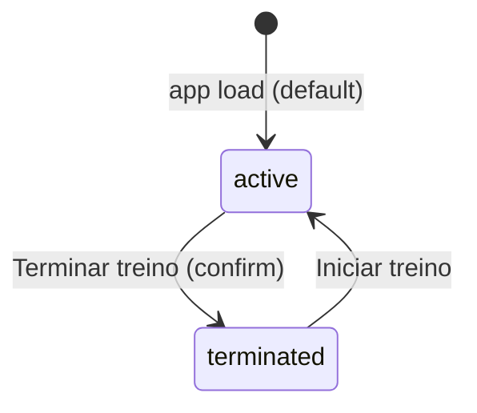

# Session state machine

## Phases

- **active**: user records weight/reps; inputs, navigation and "Terminar treino" enabled; "Iniciar treino" disabled.
- **terminated**: inputs/navigation/"Terminar treino" disabled; values remain visible; series tabs stay enabled (read-only consultation); "Iniciar treino" enabled.

## Transitions

### Terminar treino (`terminateWorkout`)
- Sets `sessionPhase = 'terminated'`.
- No archiving happens here.

### Iniciar treino (`startWorkout`) — only when `terminated`
1. For each series (A, B), against the same `currentSession`:
   - If `sessionIsComplete(session, seriesIds)`: archive as `lastCompletedSession` (with `completedAt`) and copy all sets into `suggestions`.
   - Else if the session has any data for that series: merge only complete sets into `suggestions` (preserving previous refs in other slots); do **not** update `lastCompletedSession`.
2. Create a new `currentSession` with empty sets (`buildEmptySetsForExercises`) for the **active** series, `exerciseIndex = 0`, phase `active`.
3. Persisted by `app.js` after the call.

## UI binding

`applySessionPhase()` toggles `session-terminated`/`session-active` body classes and disables the relevant controls. Called on init, series switch, navigation and after Terminar/Iniciar.
